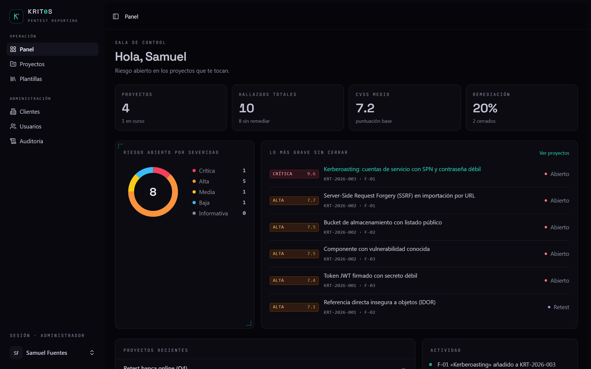
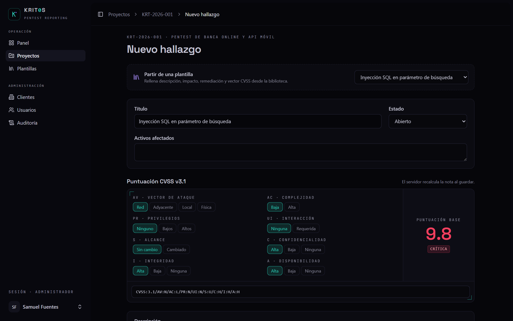
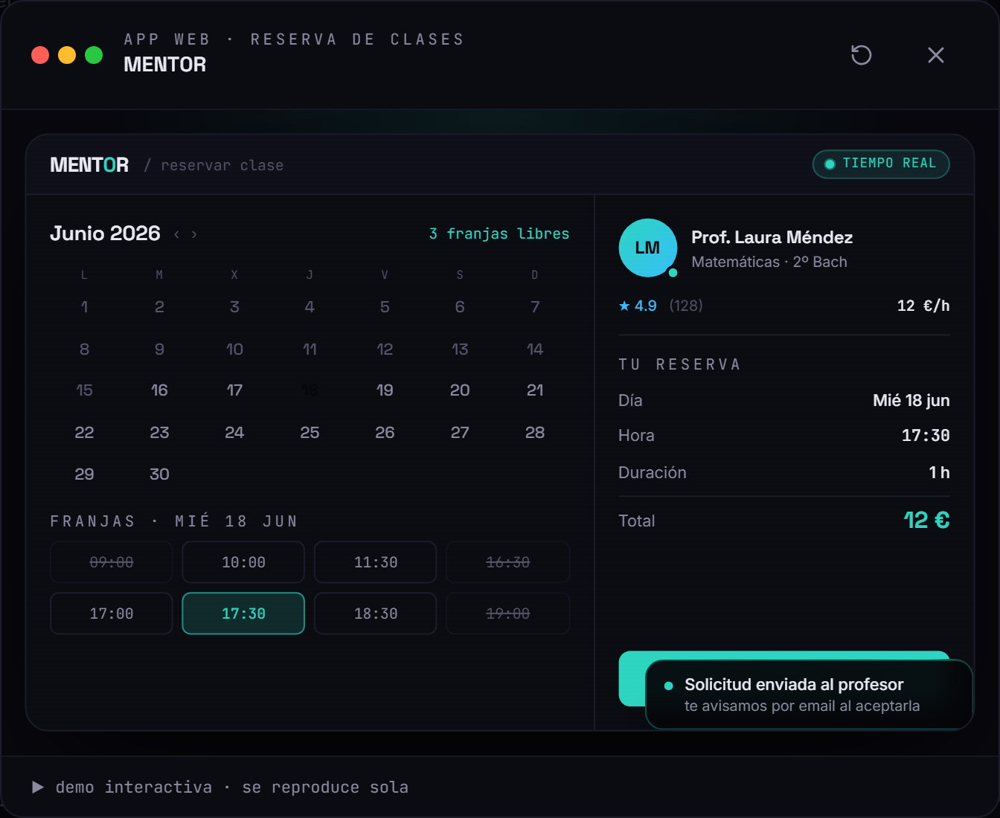
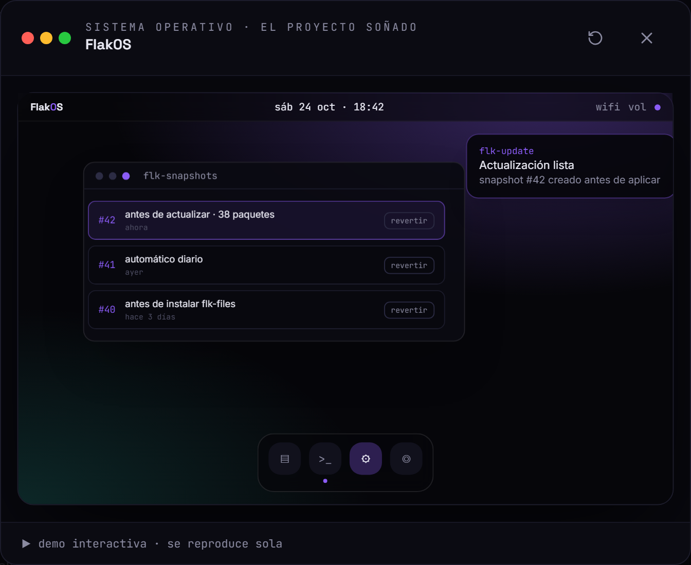

 

 

<!-- ─────────────── KAIR0S ─────────────── -->

### ⚽ KAIR0S &nbsp;·&nbsp; `SaaS · deporte` &nbsp; 🟢 en producción

**Clubes que gestionan carga, lesiones y vídeo en hojas de cálculo sueltas → un solo panel, del GPS al clip del partido.**

Los jugadores responden RPE y wellness desde el móvil, el staff importa el GPS (Catapult / STATSports) y KAIR0S calcula sola la carga semanal y el ACWR. Partidos etiquetados con seis teclas, mapa de tiros y clips cortados con FFmpeg. Cada club solo ve sus datos: el aislamiento lo hace Row-Level Security en Postgres, no la interfaz.

<table>
  <tr>
    <td width="33%"></td>
    <td width="33%"></td>
    <td width="33%"></td>
  </tr>
</table>

**[→ kair0s.es](https://kair0s.es/r/web)** &nbsp;·&nbsp; **[escaparate](https://github.com/NotSaam/kair0s-showcase)** &nbsp;·&nbsp; 561 commits · +4.800 tests

 

<!-- ─────────────── KRIT0S ─────────────── -->

### 🛡️ KRIT0S &nbsp;·&nbsp; `ciberseguridad · reporting de pentest` &nbsp; 🔵 MVP v1

**Informes de pentest en Word y CVSS calculado a mano → del hallazgo al veredicto en una sola plataforma.**

<table>
  <tr>
    <td width="50%"></td>
    <td width="50%"></td>
  </tr>
</table>

Proyectos con alcance y equipo, hallazgos puntuados con CVSS 3.1 que **el servidor recalcula siempre**, plantillas OWASP / AD / cloud y un PDF generado en una cola Redis como versión inmutable con huella SHA-256. Tres roles con Policies (admin, pentester y cliente con portal de solo lectura) y auditoría append-only. 60 tests Pest y CI sobre PostgreSQL real.

**[→ krit0s.vercel.app](https://krit0s.vercel.app)** &nbsp;·&nbsp; **[código](https://github.com/NotSaam/KRIT0S)**

 

<!-- ─────────────── SYNK0S · PHAR0S ─────────────── -->

<table>
  <tr>
    <td width="50%" valign="top">
      
      <h3>⚡ SYNK0S</h3>
      <code>app web · tiempo real</code> &nbsp; 🟢 demo en vivo
      
<b>Tableros que hay que recargar → un kanban donde cada cambio llega al resto en milisegundos.</b>

      
Sin registro: compartes el enlace y trabajáis a la vez con cursores en vivo y presencia. UI optimista, ordenación fraccional y un servidor Socket.IO que valida cada operación con Zod, aísla tableros y limita peticiones.

      
<code>Next.js 15</code> <code>Socket.IO</code> <code>Drizzle</code> <code>Zod</code> <code>dnd-kit</code>

      
<a href="https://synk0s.onrender.com"><b>→ demo</b></a> · <a href="https://github.com/NotSaam/SYNK0S"><b>código</b></a>

    </td>
    <td width="50%" valign="top">
      
      <h3>🛰️ PHAR0S</h3>
      <code>ciberseguridad · SOC</code> &nbsp; 🟣 RC v1.0
      
<b>Cinco herramientas de seguridad inconexas → un ecosistema con SSO, IA y observabilidad de extremo a extremo.</b>

      
Blue Team con detección como código y MITRE ATT&amp;CK, Red Team con agentes de IA, copiloto con RAG y reporting. Seis servicios bajo un único SSO con MFA y RBAC.

      
<code>Next.js 14</code> <code>FastAPI</code> <code>PostgreSQL</code> <code>OpenTelemetry</code>

      
<a href="https://github.com/NotSaam/FLK0S-Ecosystem"><b>→ código y capturas</b></a>

    </td>
  </tr>
  <tr>
    <td width="50%" valign="top">
      
      <h3>📅 MENT0R</h3>
      <code>app web · reserva de clases</code> &nbsp; 🔵 MVP
      
<b>Cuadrar horarios profe–familia por chat → reservas con disponibilidad real y confirmación al instante.</b>

      
Asistente paso a paso con asignatura, franja y modalidad; el profesor acepta desde su panel y cada paso llega por email. Transacciones contra dobles reservas.

      
<code>Next.js 16</code> <code>Prisma</code> <code>Auth.js</code> <code>Zod</code>

      
<a href="https://flako-dev.vercel.app/#proyectos"><b>→ demo interactiva</b></a>

    </td>
    <td width="50%" valign="top">
      
      <h3>🖥️ Flak0S</h3>
      <code>sistema operativo · el proyecto soñado</code> &nbsp; 🟠 en desarrollo
      
<b>Ningún sistema operativo está hecho a mi medida → construir el mío.</b>

      
Escritorio FLK sobre Wayland, servicios en Rust (broker D-Bus con Polkit, actualizaciones con snapshots Btrfs y rollback) y apps propias. Fluido desde 4 GB de RAM.

      
<code>Rust</code> <code>Wayland</code> <code>Btrfs</code> <code>Tauri</code>

      
<code>▰▰▰▱▱▱▱</code> hito 2 de 7 · escritorio

    </td>
  </tr>
</table>

**[Todos los proyectos con sus demos interactivas → flako-dev.vercel.app](https://flako-dev.vercel.app/)**

 

   
  
    
  
    

<table>
  <tr>
    <td width="25%" valign="top"><b>🔐 Seguridad de serie</b> SSO, MFA, RBAC, RLS en base de datos y auditoría append-only desde el primer commit.</td>
    <td width="25%" valign="top"><b>🤖 IA aplicada</b> Visión por computador, agentes y RAG metidos en productos reales, no en demos sueltas.</td>
    <td width="25%" valign="top"><b>🏗️ Full-stack</b> Del modelo de datos a la UI. El servidor decide; el cliente solo muestra.</td>
    <td width="25%" valign="top"><b>📦 DevOps</b> Docker, CI con bases de datos reales, colas y despliegues reproducibles.</td>
  </tr>
</table>

   
  
    
  <picture>
    <source media="(prefers-color-scheme: dark)" srcset="https://raw.githubusercontent.com/NotSaam/Notsaam/output/snake-dark.svg"/>
    <source media="(prefers-color-scheme: light)" srcset="https://raw.githubusercontent.com/NotSaam/Notsaam/output/snake-light.svg"/>
    
  </picture>
    
  
  &nbsp;
  

 

<code>flako@dev:~$</code> disponible para oportunidades y colaboración técnica · <a href="mailto:samufuentesp@gmail.com">samufuentesp@gmail.com</a>

